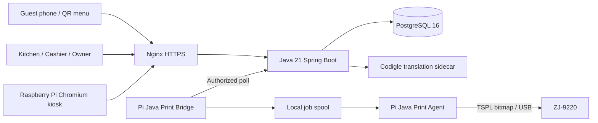

# Aliator CashRegister — Architecture / アーキテクチャ

## Components

**Java API:** restaurant-scoped authentication, QR/table sessions, menu/product modifiers, orders, kitchen status, simulated checkout, owner reporting and print-job generation.

**PostgreSQL:** tenant-owned records, orders and translations, plus durable print-job lifecycle. Client-provided prices are not trusted as final totals.

**Frontend:** responsive HTML/CSS/JavaScript dashboard, POS, guest ordering, menu editor, kitchen and report pages, with app UI localization separated from asynchronous product translations.

**Printer bridge:** authenticates a single physical Raspberry Pi to the server. Approved restaurants can share it via server-side device grants without replacing the physical device token.

**Printer agent:** consumes locally spooled jobs, renders Japanese text to monochrome bitmaps, and sends TSPL over USB. Physical printer configuration used in the demo: 58 mm continuous roll / GAP 0. Other devices may require different commands.

**Translation:** Japanese master menu; optional asynchronous EN/ZH/KO/TR menu content translated using Codigle's separate cloud provider service (DeepL/Google). Queue status and completeness should be checked per tenant/language.

## Typical print-job states

`PENDING → CLAIMED → SENT` with `UNCERTAIN` when final print outcome is unclear. `SENT` is not a sensor-verified guarantee that paper printed. Blind retries of ambiguous print jobs can produce duplicates.

## Deployment boundaries

- VPS: Java app, PostgreSQL, Nginx, server print queue and host-local Codigle translation sidecar.
- Raspberry Pi 4: Chromium kiosk + Java bridge + Java printer agent + USB printer.
- Staff login, OTP email credentials, printer tokens and DB data must remain private.
- The repository will include setup examples only after the final deployed source has been sanitized.
