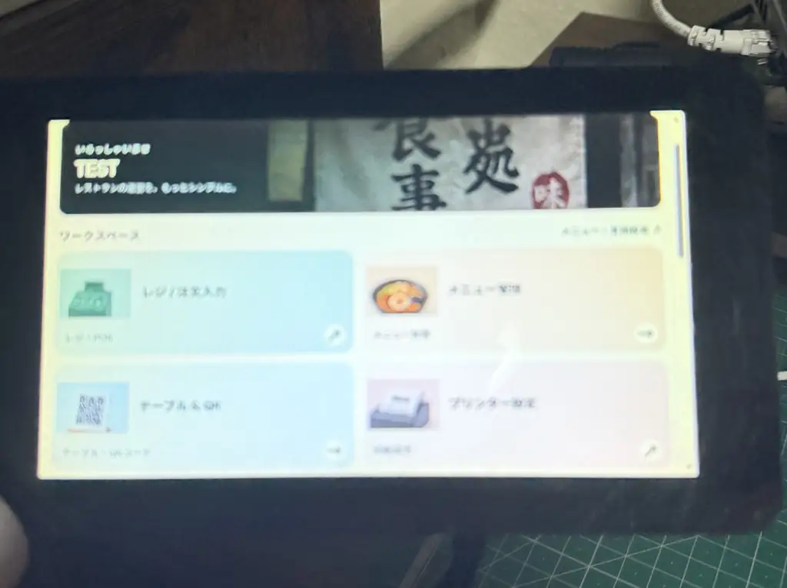
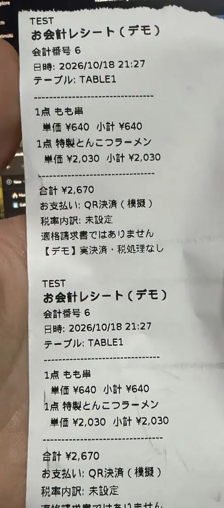
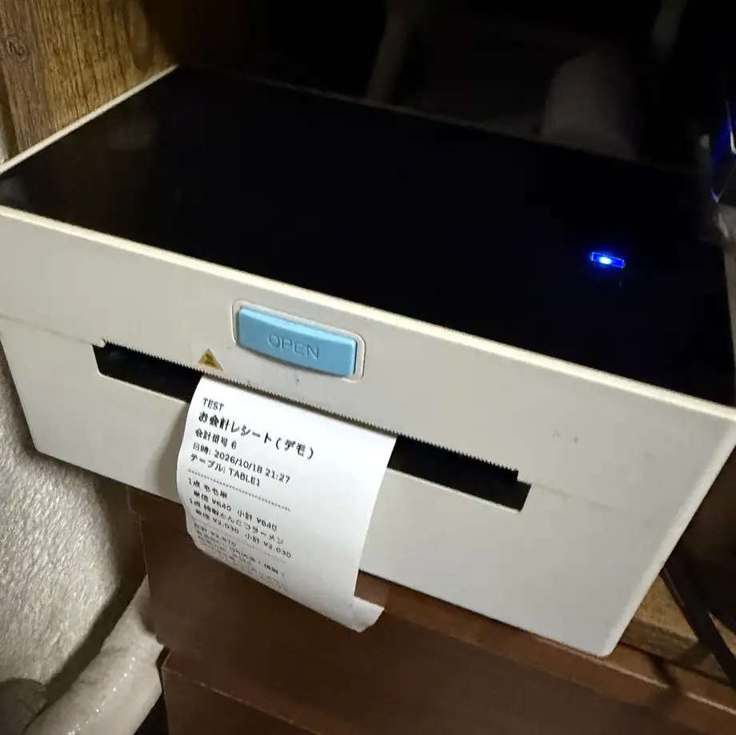
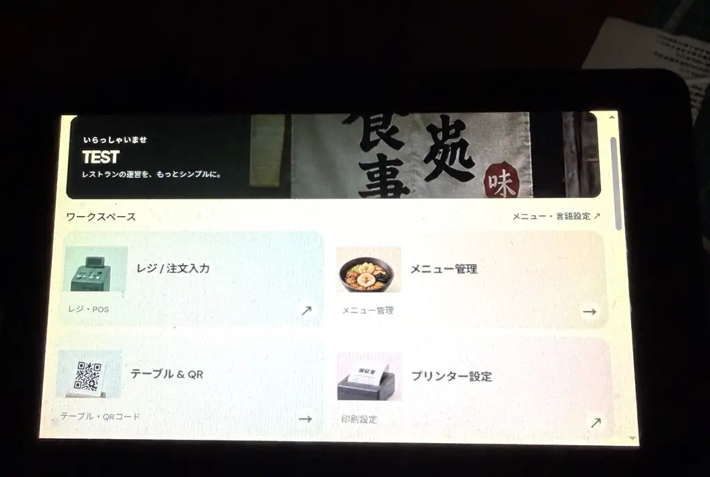

# Aliator CashRegister

**Java-based multi-restaurant ordering, POS demonstration and Japanese receipt printing.**

**日本語:** Java / Spring Boot と Raspberry Pi を使用した、複数店舗対応の飲食店向け注文・会計デモシステム。QRコード注文、キッチン画面、店舗管理、売上レポート、USBプリンター連携を備えています。

> **Portfolio demo — not a commercial payment or fiscal system.** Cash, card and QR payments are simulated; the PayPay API is not connected. Receipts are not certified tax or Qualified Invoice documents.

**Live demo:** https://cashregister.aliator.com/

## Watch the demo / デモ動画

[](https://www.youtube.com/watch?v=K00qFp7NA4k)

▶ **[Watch the Aliator CashRegister demo on YouTube](https://www.youtube.com/watch?v=K00qFp7NA4k)**  
▶ **[Aliator CashRegister のデモ動画を見る](https://www.youtube.com/watch?v=K00qFp7NA4k)**

This video accompanies the Java/Spring Boot restaurant system and Raspberry Pi hardware portfolio. Further photos of the touchscreen and printer will be added to the [media gallery](media/README.md).

## Features / 主な機能

- **Restaurant management / 店舗管理:** tenant-isolated owner accounts, menu editing, tables and QR codes, printer settings.
- **Guest ordering / QR注文:** table-bound guest sessions, product options, cart and order history.
- **Kitchen / キッチン:** incoming orders, preparation status, optional service confirmation and automatic kitchen tickets.
- **Cashier / レジ:** table selection, simulated cash/card/QR checkout, optional payment receipt.
- **Reports / 売上分析:** order and recorded demo-payment summaries per restaurant.
- **Printer / 印刷:** Raspberry Pi 4, Java print bridge/agent, durable spool, USB TSPL, dynamic-length 58 mm continuous-roll tickets with Japanese bitmap text.
- **Languages / 多言語:** Japanese menu source, user-selectable interface languages, asynchronous menu translation via a separate Codigle DeepL/Google translation service.
- **Touch UI:** responsive desktop/mobile and 7-inch Chromium kiosk experience.
- **Authentication:** email OTP registration and password recovery.

## Stack / 使用技術

| Area | Technology | Why / 用途 |
| --- | --- | --- |
| Backend | Java 21, Spring Boot, REST | Ordering, accounts, restaurant separation, payment demo, reporting, print jobs |
| Database | PostgreSQL 16 | Restaurants, menus, tables, orders, payments, translation and print-job records |
| Web UI | HTML, CSS, vanilla JavaScript | Guest menu, POS, kitchen, owner dashboard and localization |
| Deployment | Docker Compose | API and database services |
| Public edge | Nginx + HTTPS | Secure reverse proxy |
| Touch terminal | Raspberry Pi OS, labwc/Wayland, Chromium | 7-inch kiosk |
| Printing | Java Print Bridge + Agent, systemd, USB, TSPL | Authenticated job pickup and Japanese ticket rendering |
| Translation | Codigle Cloud Translation sidecar | Background menu translation using DeepL/Google providers |

## Architecture / システム構成

```text
Phone / staff browser / Pi kiosk
              |
          Nginx HTTPS
              |
     Java 21 / Spring Boot ---- PostgreSQL
              |               (restaurant-scoped records)
              +---- Codigle translation service
              |
        Printer job queue
              ^
              | authenticated poll
        Raspberry Pi 4
        Java Print Bridge
              |
         local spool
              |
        Java Print Agent
              |
        USB / TSPL bitmap
              |
        ZJ-9220 printer
```

See [ARCHITECTURE.md](ARCHITECTURE.md) for the workflow and boundaries.

## Demonstration sequence / デモの流れ

1. Restaurant owner signs in and edits the Japanese menu.
2. Guest scans the table QR code and submits a modified ramen order.
3. Kitchen receives the order; if enabled, a Japanese kitchen ticket is automatically queued and printed.
4. Staff completes preparation and optionally marks the order served.
5. Cashier selects the table, completes a **simulated** payment and optionally queues a receipt.
6. Owner views tenant-scoped reports and manages menu languages.


## Raspberry Pi demonstration / Raspberry Pi 実機デモ

The hardware side includes a **Raspberry Pi 4 + 7-inch touchscreen**, Chromium kiosk under **labwc/Wayland**, independent Java **Print Bridge** and **Print Agent** services, and a **Zjiang ZJ-9220 USB printer**. The demo prints Japanese monochrome bitmap tickets on **58 mm continuous roll (GAP 0)**, with variable ticket length calculated from text content. One physical printer can be granted to more than one authorized restaurant.

Read [Raspberry Pi Integration](raspberry-pi/README.md), the bilingual [Development Journey](docs/DEVELOPMENT-JOURNEY.md), and [Demo Photos/Video](media/README.md). A [demo video](https://www.youtube.com/watch?v=K00qFp7NA4k) and actual hardware photos are available below.

## Hardware gallery / 実機写真

These are photographs of the **actual Raspberry Pi touch kiosk and USB printer** used for this demo, not rendered mockups.

| 7-inch touchscreen / 7インチ画面 | Japanese receipt / 日本語レシート |
| :---: | :---: |
| [](media/images/raspberry-pi-dashboard-handheld.webp) | [](media/images/receipt-japanese-closeup.webp) |
| **Touch kiosk:** Chromium + labwc, responsive restaurant tiles | **Receipt:** variable length, Japanese bitmap text, simulated QR payment |

| USB printer / USBプリンター | Workspace screen / 店舗管理画面 |
| :---: | :---: |
| [](media/images/zj9220-printer-receipt.webp) | [](media/images/raspberry-pi-workspace-screen.webp) |
| **Printing:** Raspberry Pi Java bridge/agent → USB ZJ-9220 | **Interface:** Japanese workspace on the 7-inch display |

日本語: Raspberry Pi 4と7インチタッチ画面、Java製印刷ブリッジ、USB接続プリンターを使用した実機デモです。58 mm連続ロール紙に日本語レシートを印刷しています。レシートは**決済・税処理を伴わないデモ**です。

## Repository publication status

**Documentation is published first.** The current live Java/frontend/Pi source tree is being collected and sanitized before public upload. Earlier incremental deployment ZIPs are **not** a complete reproducible source release. Once the live snapshot is reviewed, buildable application code, tests and local setup instructions will be added here.

**Do not commit:** production `.env` files, email/API keys, printer bearer tokens, private logs, real customer/tenant records, DB dumps or backups. See [SECURITY.md](SECURITY.md).

## Known limits

This is a Java engineering portfolio project. **No real PayPay or other real-money processing, certified tax/Qualified Invoice compliance, or guarantee of receipt physical delivery.** `SENT` denotes print handoff/acknowledgment, not sensor-verified output. Actual ingredients, allergens and tax data need restaurant verification.

---

**日本語の注意:** 本ソフトウェアはポートフォリオ用デモです。実決済、法定領収書、アレルゲン情報の正確性は保証していません。本番認証情報や顧客データをGitHubに公開しないでください。
